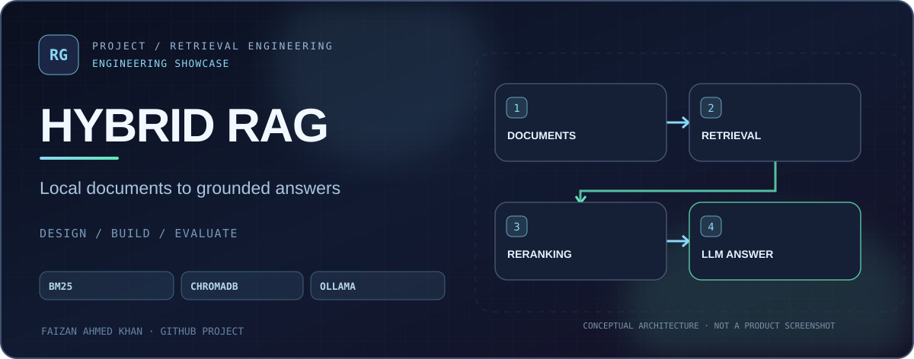
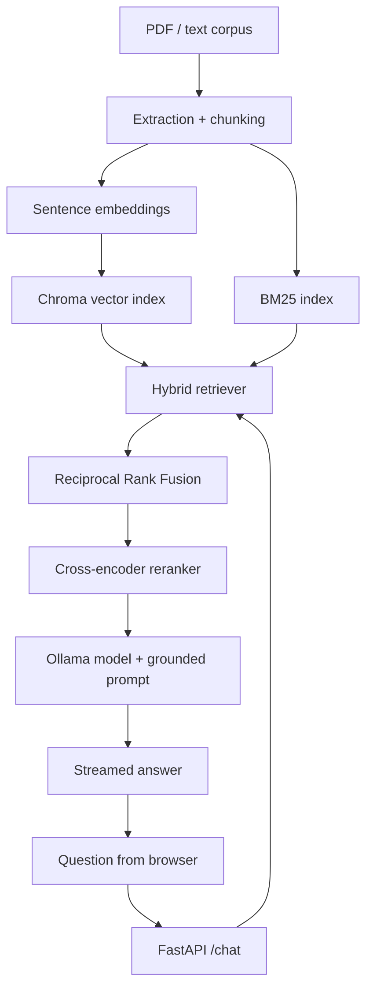

<div align="center">
  <a href="https://github.com/FaizanAKhan786/production-rag-chatbot"></a>
  <br />


# Production RAG Chatbot
### Hybrid retrieval and locally served answers

**FastAPI · BM25 · ChromaDB · Cross-encoder reranking · Ollama**


[Quick start](#quick-start) · [Architecture](#architecture) · [Evaluation](#evaluation-and-tests) · [Source](https://github.com/FaizanAKhan786/production-rag-chatbot)

</div>

## Overview

A **retrieval-augmented generation chatbot** built to answer questions grounded in locally indexed documents. Unlike a plain vector search example, it demonstrates lexical and embedding retrieval, reciprocal-rank fusion, reranking and streaming responses.

| Step | Implementation |
| --- | --- |
| Input | Local PDF/text document corpus |
| Processing | Document extraction, chunking and metadata |
| Indexing | ChromaDB dense vectors + BM25 lexical index |
| Ranking | Hybrid retrieval, RRF fusion and reranking |
| Generation | Local Ollama model |
| Interface | FastAPI routes + a lightweight built-in web UI |

## Architecture



## Quick start

**Requirements:** Python 3.11+, Ollama, and model files available locally. A first run may download embeddings/reranker weights.

```bash
git clone https://github.com/FaizanAKhan786/production-rag-chatbot.git
cd production-rag-chatbot
python -m venv .venv
source .venv/bin/activate    # Windows: .venv\Scripts\activate
pip install -e ".[dev]"
cp .env.example .env
ollama pull qwen2.5:14b
```

Create a corpus directory, add documents you are permitted to process, and index them:

```bash
mkdir -p data/corpus
python scripts/ingest.py --corpus-dir data/corpus
uvicorn src.api.main:app --host 127.0.0.1 --port 8000 --reload
```

Launch [the local browser UI](http://localhost:8000) or inspect [FastAPI docs](http://localhost:8000/docs). Ollama must be running separately. The default model requires significant RAM; adapt your configuration for smaller hardware.

## Evaluation and tests

```bash
pytest -q
python scripts/run_eval.py --help
```

The evaluation and retrieval utilities are in [`src/eval/`](src/eval/) and [`scripts/`](scripts/). This README does **not** claim independently measured accuracy, production uptime or a successful live deployment.

## Project map

| Path | Description |
| --- | --- |
| [`src/ingestion/`](src/ingestion/) | Extraction and chunking |
| [`src/retrieval/`](src/retrieval/) | Indexes, hybrid search and reranker |
| [`src/llm/`](src/llm/) | Ollama integration |
| [`src/api/`](src/api/) | HTTP API and streaming routes |
| [`static/`](static/) | Browser interface |
| [`tests/`](tests/) | Test suite |
| [`.env.example`](.env.example) | Config reference |

## Boundaries

The project is intended for **self-hosted experimentation and engineering demonstration**. Adding documents does not guarantee accurate answers; inspect citations and evaluate retrieval quality for your use case. Avoid uploading sensitive documents to an unreviewed environment.

[Issues](https://github.com/FaizanAKhan786/production-rag-chatbot/issues) · [GitHub profile](https://github.com/FaizanAKhan786)
